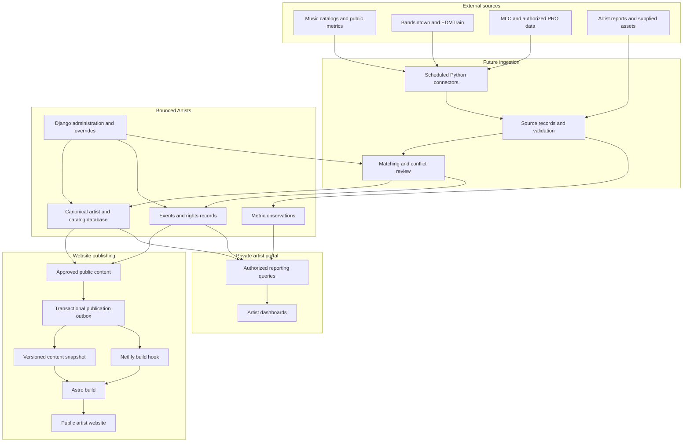

# Database architecture

Bounced Artists uses one Django application and the existing PostgreSQL database.
The seven domain apps contain 72 models, with three additional portal support
tables for login limits, private change history and review requests. Existing
artist UUIDs and the legacy private read API are preserved. [The dictionary](schema-dictionary.md)
lists domain tables and fields; [ER views](entity-relationships.md) show foreign
keys. This describes the checkout; see status for what has actually been deployed.

This is the current architecture reference. [Status](status.md) owns dated live
evidence; [operations](operations.md) owns commands and infrastructure identifiers.

## Module map

| Module | Implemented responsibility |
| --- | --- |
| `config`, `core` | Environment settings, routes, WSGI, custom user, probes |
| `artists` | Organizations, identities, memberships, contacts, services, private API, seeds/importer |
| `catalog` | Recordings, releases/tracks, identifiers, credits, assets, genres, platform matches |
| `rights` | Parties, works, contributors, affiliations, registrations and evidence-specific claims |
| `events` | Event/venue/source/ticket schema and Admin; no event connector |
| `provenance` | Source snapshots, connections/jobs/runs, observations, overrides, review and audit schema |
| `publishing` | Website/draft pages, SEO, fanlinks, transactional approval/outbox; no delivery |
| `analytics` | Metric definitions/series/observations, report/audio/playlist schema; no collection |
| `portal` | Session login, responsive artist workspace, explicit scoped editorial CRUD, validated private media and review UI |

## Implemented endpoints and access

| Path | Behavior |
| --- | --- |
| `/health/` | Liveness, no DB query; status only |
| `/ready/` | Database `SELECT 1`; generic 503 on failure |
| `/admin/` | Session-authenticated staff management with model permissions |
| `/api-auth/login/` | Existing-account session login, no public registration |
| `/api/v1/artists/` and `<uuid>/` | Active-authenticated, membership-scoped artist list/detail |
| `/` and `/app/` | Styled login and membership-scoped overview/catalog/song/release journey |
| `/app/artists/<uuid>/data/...` | Scoped editorial forms, records and removal/restoration |
| `/api/portal/v1/artists/<uuid>/<resource>/` | Session-authenticated editorial CRUD, explicit fields and CSRF |
| `/api/public/v1/artists/<approved_slug>/...` | Anonymous read-only approved artist/catalog/fanlinks and selected sanitized artwork |

Legacy artist API methods are GET/HEAD/OPTIONS only. Owner/editor/viewer retain
the same scoped read access there. In the separate portal, owners/editors edit
explicitly assigned `manage` resources; viewers read assigned resources. Only
owner/staff can archive an artist workspace. Membership administration stays in
the superuser-controlled Admin. Non-staff
querysets filter membership before UUID retrieval, returning 404 for another artist.
Django model permissions alone do not bypass this scope. Staff are trusted global
operators; artist portal users must remain non-staff. Only superusers administer
users and memberships; group administration is not exposed.

Portal workspaces include only active managed artists; collaborators remain
available as catalog credits without becoming workspaces. Every selected workspace
uses explicit catalog grants, including for staff, and child records/relationship
choices inherit that scope. Global staff access remains in Admin and the legacy
artist API. Overview remembers the last validated workspace, while its navigation
links carry the current artist explicitly. Switching preserves the current section
and safe collection filters; detail/form pages switch to the corresponding list.
Catalog cards display actual credits, never the selected workspace as a substitute.

Artist serializer fields are explicitly allowlisted: ID, name, slug, management
status, biographies, location, timezone and timestamps. Contacts, memberships,
profile links and legal-party data are excluded. Contacts default to staff-only;
even a contact marked public is not published by a current endpoint. New fields
or private endpoints require explicit scope/privacy checks. Organization membership
and catalog credits do not automatically grant artist API access.

The artist seed creates missing Dezolent, SRY4U and Morbeato as managed artists.
Immutable bootstrap keys preserve seed identity after slug edits; edited fields
and management status are preserved. Reference seeds assert no society affiliation.

The following workflow includes future connectors and website delivery; the portal
and approved API now exist in the checkout. No connector or delivery worker is
implied by the diagram.

## Boundaries and decisions

- `Organization` owns private artist, recording, release, work, event, source, website and metric data. The migration creates the known Bounced Studio organization and assigns only previously unowned artists to it. Organization and artist memberships remain distinct; a catalog credit does not grant API access. Staff are global trusted operators, and artist members retain the original scoped read-only API. No new private endpoint is exposed.
- Services, genres, rights societies and platform objects are reusable references. A platform object identifies one service listing; matches connect it to canonical recordings, releases or artists. Collector, method and parser identity live on `SourceRecord`, separate from the platform `Service`.
- Composition, recording, release and service listing are separate. A SoundCloud-only recording needs neither release nor work. Recording-work links and release tracks are many-to-many with explicit join records. Platform recording matches record relationship type, allowing a video to contain several recordings. Titles are never uniqueness keys.
- Identifiers are strings and assertions can conflict across canonical records. A platform external ID is unique within service and object type when provided. URL-only objects deduplicate by exact URL in the same scope; URL normalization and redirects need later review. Original release dates and platform upload timestamps are separate. For dates with year or month precision, store the first day of the known period and preserve `date_precision`; unknown dates stay null. Do not render invented precision.
- Assets preserve external/repository references and may have immutable uploaded
  versions. Private originals and sanitized WebP previews use authenticated media
  routes; production requires private R2 configuration. Imports still copy no files.
- `EntityTarget` is a typed registry with one real foreign key, a database exactly-one check and organization validation. `FieldObservation` and `EditorialOverride` allow only listed target fields. `ReviewCandidate` checks organization before save. Operational ORM paths use `full_clean`; bulk writes must pass equivalent checks. `AuditEvent.target_label` may survive removal of its typed target. Source payload and audit validation reject common credential keys, but collectors must also sanitize incoming documents before storage.
- Rights claims remain source-specific. Shares carry basis, territory and dates, with no artificial 100% sum. `not_found` is different from `confirmed_unregistered`. A legal party name is never on the public artist serializer.
- The reference seed creates MLC, ASCAP and BMI definitions only; it asserts no artist affiliation or registration. Their classifications follow [The MLC](https://www.themlc.com/), [ASCAP](https://www.ascap.com/), and [BMI](https://www.bmi.com/about). Existing edits to reference rows are preserved.
- Events can be date-only, without venue or precise time. Status holds cancellation or postponement independent of whether the date is past. Ticket offers validate that their source belongs to the same event.
- Metric definitions identify aggregation semantics. Dimensions use sorted compact UTF-8 JSON before SHA-256 hashing. For one series and period, `current_accepted` selects the highest accepted revision, breaking ties by observation time and UUID. Null is unavailable, not zero. Unique listener counts must not be summed across services or periods. Playlist appearances are observations, not continuous-membership claims. Audio analysis records its actual engine.
- `PublicationOutbox` retains its separate legacy approval/request service. Portal
  approval uses immutable `ApprovedCatalogRevision` snapshots and an active website
  pointer, with exact nested allowlists, opaque public IDs and staff-reviewed safe
  destination URLs. Private edits do not change snapshots. Deleting included
  content or withdrawing asset rights revokes affected projections. Original
  contacts, legal-party fields, sources, identifiers, metrics and credentials are
  excluded. This approval makes no outbox entry or external delivery request.

`ArtistResourceGrant` is an explicit, same-organization assignment to a recording,
release, asset, work, party or event. Both membership and assignment are required;
credits and organization membership confer no access. Nested choices and reads
also check secondary records. Mutations lock membership/grants, check signed
edit versions, validate writes and record private change history. Removal preserves
imported rows; recreating a unique relationship reactivates its stable UUID with
an audited restore, so primary artwork and track positions can be replaced.

Assets have an optional allowlisted category, editable through the private portal.
The asset table supports category filters and type/name sorting. Text files use
file-type icons; details read at most 256 KiB from an authorized stored version
and render escaped text. No remote text URL is fetched, and original downloads
retain attachment disposition. Subtitle and manifest uploads require valid UTF-8.

Shared social/platform logos are application static assets in
`portal/static/portal/library/`, exposed through the reusable
`catalog.brand_library.brand_logo` lookup and a read-only Shared library tab in
every workspace. They do not confer access to another artist's Asset rows.
Exact known imported logo references are excluded from artist grants/CRUD; the
reviewed `organize_assets` command removes their obsolete grants and fills blank
categories, preserving original files, UUIDs, import mappings and source evidence.
Future catalog assignment excludes these references. Artist logos remain private
workspace assets. Brand artwork is also used on platform/fanlink destinations.

## Capability matrix

| Capability | Foundation status |
| --- | --- |
| Staff Admin, artist-scoped private read API | Implemented and preserved |
| Organization, website, catalog, rights, events, provenance, metric schema | Implemented; populated where supported by the Dezolent import |
| Idempotent service references and artist ownership backfill | Implemented |
| Transactional approval and publication request | Implemented service function; no delivery |
| Verified Dezolent website bundle importer | Implemented and applied; source snapshots and typed rows, no publishing |
| External APIs, scrapers, MLC/PRO and event connectors | Future |
| Approved-content API and artist workspace | Implemented in checkout; deployment tracked separately |
| Netlify hook, Astro migration and analytics collection | Outside this implementation |

## Import and future integration boundaries

The [Dezolent import contract](dezolent-import-plan.md) describes stable source
identity, full snapshot preservation and conflict handling. Website titles and
ISRC/ISWC claims are evidence rather than authoritative uniqueness or verified
rights. Imports leave publishing records in draft. Review imported source conflicts
before approving imported public projections; external connector scheduling,
snapshot export, Netlify delivery and website migrations remain separate future work.
