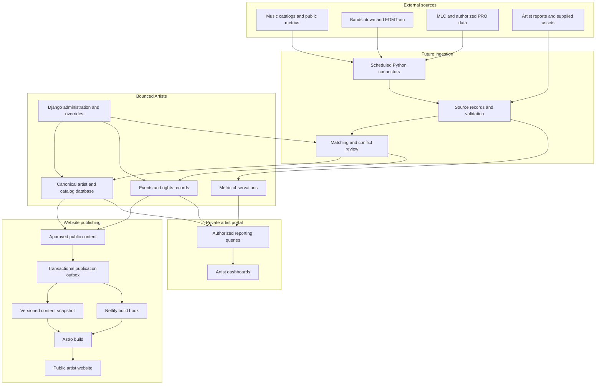

# Database architecture

Bounced Artists uses one Django application and the existing PostgreSQL database. The seven domain apps contain 67 models. `artists` extends the original artist, membership and service models in place; `core.User`, existing artist UUIDs, and the private read API remain unchanged. [The dictionary](schema-dictionary.md) lists physical tables and fields; [ER views](entity-relationships.md) show foreign keys by domain.

The following full workflow is the intended architecture. Boxes for future connectors, delivery and dashboards describe direction, not implemented runtime features.

## Boundaries and decisions

- `Organization` owns private artist, recording, release, work, event, source, website and metric data. The migration creates the known Bounced Studio organization and assigns only previously unowned artists to it. Organization and artist memberships remain distinct; a catalog credit does not grant API access. Staff are global trusted operators, and artist members retain the original scoped read-only API. No new private endpoint is exposed.
- Services, genres, rights societies and platform objects are reusable references. A platform object identifies one service listing; matches connect it to canonical recordings, releases or artists. Collector, method and parser identity live on `SourceRecord`, separate from the platform `Service`.
- Composition, recording, release and service listing are separate. A SoundCloud-only recording needs neither release nor work. Recording-work links and release tracks are many-to-many with explicit join records. Platform recording matches record relationship type, allowing a video to contain several recordings. Titles are never uniqueness keys.
- Identifiers are strings and assertions can conflict across canonical records. A platform external ID is unique within service and object type when provided. URL-only objects deduplicate by exact URL in the same scope; URL normalization and redirects need later review. Original release dates and platform upload timestamps are separate. For dates with year or month precision, store the first day of the known period and preserve `date_precision`; unknown dates stay null. Do not render invented precision.
- Assets point to external URLs, repository paths or future storage keys. Private assets require organization ownership; rights basis and visibility govern later publication. No files have been copied.
- `EntityTarget` is a typed registry with one real foreign key, a database exactly-one check and organization validation. `FieldObservation` and `EditorialOverride` allow only listed target fields. `ReviewCandidate` checks organization before save. Operational ORM paths use `full_clean`; bulk writes must pass equivalent checks. `AuditEvent.target_label` may survive removal of its typed target. Source payload and audit validation reject common credential keys, but collectors must also sanitize incoming documents before storage.
- Rights claims remain source-specific. Shares carry basis, territory and dates, with no artificial 100% sum. `not_found` is different from `confirmed_unregistered`. A legal party name is never on the public artist serializer.
- The reference seed creates MLC, ASCAP and BMI definitions only; it asserts no artist affiliation or registration. Their classifications follow [The MLC](https://www.themlc.com/), [ASCAP](https://www.ascap.com/), and [BMI](https://www.bmi.com/about). Existing edits to reference rows are preserved.
- Events can be date-only, without venue or precise time. Status holds cancellation or postponement independent of whether the date is past. Ticket offers validate that their source belongs to the same event.
- Metric definitions identify aggregation semantics. Dimensions use sorted compact UTF-8 JSON before SHA-256 hashing. For one series and period, `current_accepted` selects the highest accepted revision, breaking ties by observation time and UUID. Null is unavailable, not zero. Unique listener counts must not be summed across services or periods. Playlist appearances are observations, not continuous-membership claims. Audio analysis records its actual engine.
- `PublicationOutbox` has one website content version and a separate idempotency key. `approve_page_and_request_publication` updates an approved page and inserts the request in one transaction while locking the website row. No worker, snapshot export or Netlify call exists. A future public API must explicitly allow only approved artist name/slug/biography/location, approved catalog display fields, public licensed artwork and approved destination URLs; private contacts, legal names, sources, metrics and credentials are excluded.

## Capability matrix

| Capability | Foundation status |
| --- | --- |
| Staff Admin, artist-scoped private read API | Implemented and preserved |
| Organization, website, catalog, rights, events, provenance, metric schema | Implemented as empty relational tables |
| Idempotent service references and artist ownership backfill | Implemented |
| Transactional approval and publication request | Implemented service function; no delivery |
| Astro catalog import or reconciliation | Next phase |
| External APIs, scrapers, MLC/PRO and event connectors | Future |
| Public content API, Netlify hook and Astro migration | Future |
| Artist dashboards and analytics collection | Future |

## Next catalog-import phase

Inventory the existing Dezolent Astro `src/lib` modules with a read-only parser. Review song/release identity, collaborations, source URLs and licensed cover paths with the artist; do not assume website titles or ISRC/ISWC claims are authoritative. Stage source records with `collection_method=manual`, reconcile canonical recordings and releases, then verify several SoundCloud-only and remix cases before importing the rest. Keep website repositories unchanged until approved public projections and build hooks are designed.
