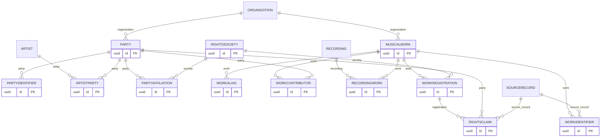
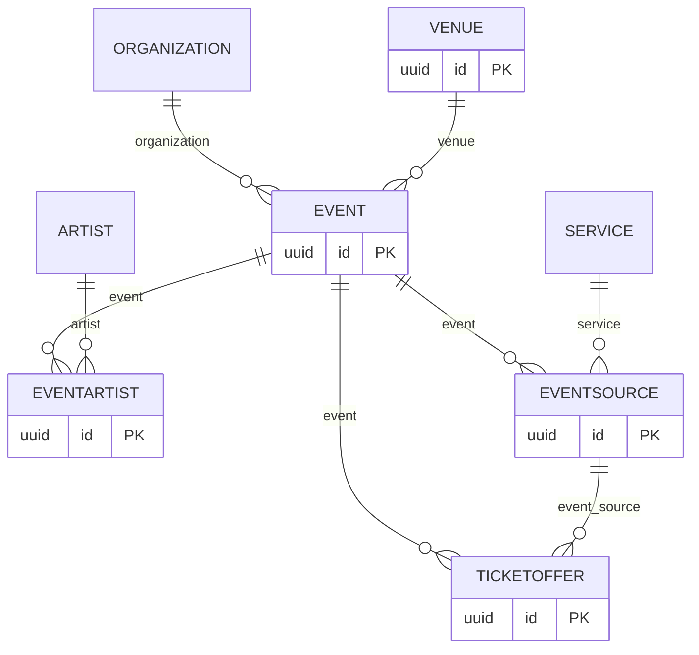
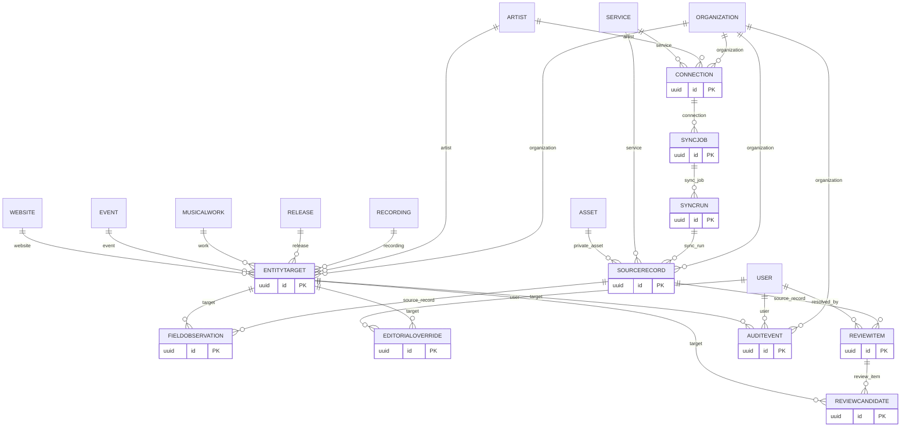
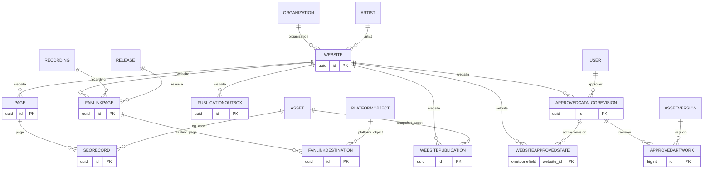
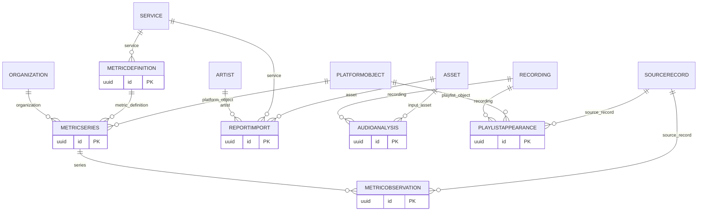

# Entity relationships

Physical tables use Django app prefixes and snake case model names. Each view includes all models in its domain; edges to another domain show foreign keys without implying shared access.

## artists

```mermaid
erDiagram
    ORGANIZATION {
        uuid id PK
    }
    ORGANIZATIONMEMBERSHIP {
        uuid id PK
    }
    ARTIST {
        uuid id PK
    }
    ARTISTMEMBERSHIP {
        bigint id PK
    }
    ARTISTALIAS {
        bigint id PK
    }
    ARTISTCONTACT {
        bigint id PK
    }
    SERVICE {
        bigint id PK
    }
    ARTISTPROFILELINK {
        bigint id PK
    }
    ARTISTRESOURCEGRANT {
        uuid id PK
    }
    ORGANIZATION ||--o{ ORGANIZATIONMEMBERSHIP : "organization"
    USER ||--o{ ORGANIZATIONMEMBERSHIP : "user"
    ORGANIZATION ||--o{ ARTIST : "organization"
    USER ||--o{ ARTISTMEMBERSHIP : "user"
    ARTIST ||--o{ ARTISTMEMBERSHIP : "artist"
    ARTIST ||--o{ ARTISTALIAS : "artist"
    ARTIST ||--o{ ARTISTCONTACT : "artist"
    ARTIST ||--o{ ARTISTPROFILELINK : "artist"
    SERVICE ||--o{ ARTISTPROFILELINK : "platform"
    ARTIST ||--o{ ARTISTRESOURCEGRANT : "artist"
    RECORDING ||--o{ ARTISTRESOURCEGRANT : "recording"
    RELEASE ||--o{ ARTISTRESOURCEGRANT : "release"
    ASSET ||--o{ ARTISTRESOURCEGRANT : "asset"
    MUSICALWORK ||--o{ ARTISTRESOURCEGRANT : "work"
    PARTY ||--o{ ARTISTRESOURCEGRANT : "party"
    EVENT ||--o{ ARTISTRESOURCEGRANT : "event"
    LABEL ||--o{ ARTISTRESOURCEGRANT : "label"
    RELEASEGROUP ||--o{ ARTISTRESOURCEGRANT : "release_group"
```

## catalog

```mermaid
erDiagram
    LABEL {
        uuid id PK
    }
    RELEASEGROUP {
        uuid id PK
    }
    RECORDING {
        uuid id PK
    }
    RECORDINGARTIST {
        uuid id PK
    }
    RECORDINGIDENTIFIER {
        uuid id PK
    }
    RECORDINGRELATION {
        uuid id PK
    }
    RELEASE {
        uuid id PK
    }
    RELEASEARTIST {
        uuid id PK
    }
    RELEASEIDENTIFIER {
        uuid id PK
    }
    MEDIUM {
        uuid id PK
    }
    RELEASETRACK {
        uuid id PK
    }
    GENRE {
        uuid id PK
    }
    ARTISTGENRE {
        uuid id PK
    }
    RECORDINGGENRE {
        uuid id PK
    }
    RELEASEGENRE {
        uuid id PK
    }
    RELEASEGROUPGENRE {
        uuid id PK
    }
    RECORDINGLABEL {
        uuid id PK
    }
    RELEASELABEL {
        uuid id PK
    }
    ASSET {
        uuid id PK
    }
    ASSETVERSION {
        uuid id PK
    }
    ARTISTASSET {
        uuid id PK
    }
    RELEASEASSET {
        uuid id PK
    }
    RECORDINGASSET {
        uuid id PK
    }
    PLATFORMOBJECT {
        uuid id PK
    }
    RECORDINGPLATFORMMATCH {
        uuid id PK
    }
    RELEASEPLATFORMMATCH {
        uuid id PK
    }
    ARTISTPLATFORMMATCH {
        uuid id PK
    }
    PLATFORMAVAILABILITY {
        uuid id PK
    }
    ORGANIZATION ||--o{ LABEL : "organization"
    PARTY ||--o{ LABEL : "party"
    ORGANIZATION ||--o{ RELEASEGROUP : "organization"
    ORGANIZATION ||--o{ RECORDING : "organization"
    RECORDING ||--o{ RECORDINGARTIST : "recording"
    ARTIST ||--o{ RECORDINGARTIST : "artist"
    RECORDING ||--o{ RECORDINGIDENTIFIER : "recording"
    SOURCERECORD ||--o{ RECORDINGIDENTIFIER : "source_record"
    RECORDING ||--o{ RECORDINGRELATION : "from_recording"
    RECORDING ||--o{ RECORDINGRELATION : "to_recording"
    ORGANIZATION ||--o{ RELEASE : "organization"
    RELEASEGROUP ||--o{ RELEASE : "release_group"
    PARTY ||--o{ RELEASE : "label_party"
    RELEASE ||--o{ RELEASEARTIST : "release"
    ARTIST ||--o{ RELEASEARTIST : "artist"
    RELEASE ||--o{ RELEASEIDENTIFIER : "release"
    SOURCERECORD ||--o{ RELEASEIDENTIFIER : "source_record"
    RELEASE ||--o{ MEDIUM : "release"
    RELEASE ||--o{ RELEASETRACK : "release"
    RECORDING ||--o{ RELEASETRACK : "recording"
    MEDIUM ||--o{ RELEASETRACK : "medium"
    ARTIST ||--o{ ARTISTGENRE : "artist"
    GENRE ||--o{ ARTISTGENRE : "genre"
    RECORDING ||--o{ RECORDINGGENRE : "recording"
    GENRE ||--o{ RECORDINGGENRE : "genre"
    RELEASE ||--o{ RELEASEGENRE : "release"
    GENRE ||--o{ RELEASEGENRE : "genre"
    RELEASEGROUP ||--o{ RELEASEGROUPGENRE : "release_group"
    GENRE ||--o{ RELEASEGROUPGENRE : "genre"
    RECORDING ||--o{ RECORDINGLABEL : "recording"
    LABEL ||--o{ RECORDINGLABEL : "label"
    RELEASE ||--o{ RELEASELABEL : "release"
    LABEL ||--o{ RELEASELABEL : "label"
    ORGANIZATION ||--o{ ASSET : "organization"
    ASSETVERSION ||--o{ ASSET : "current_version"
    ASSET ||--o{ ASSETVERSION : "asset"
    USER ||--o{ ASSETVERSION : "creator"
    ARTIST ||--o{ ARTISTASSET : "artist"
    ASSET ||--o{ ARTISTASSET : "asset"
    RELEASE ||--o{ RELEASEASSET : "release"
    ASSET ||--o{ RELEASEASSET : "asset"
    RECORDING ||--o{ RECORDINGASSET : "recording"
    ASSET ||--o{ RECORDINGASSET : "asset"
    SERVICE ||--o{ PLATFORMOBJECT : "service"
    RECORDING ||--o{ RECORDINGPLATFORMMATCH : "recording"
    PLATFORMOBJECT ||--o{ RECORDINGPLATFORMMATCH : "platform_object"
    RELEASE ||--o{ RELEASEPLATFORMMATCH : "release"
    PLATFORMOBJECT ||--o{ RELEASEPLATFORMMATCH : "platform_object"
    ARTIST ||--o{ ARTISTPLATFORMMATCH : "artist"
    PLATFORMOBJECT ||--o{ ARTISTPLATFORMMATCH : "platform_object"
    PLATFORMOBJECT ||--o{ PLATFORMAVAILABILITY : "platform_object"
```

## rights

## events

## provenance

## publishing

## analytics

